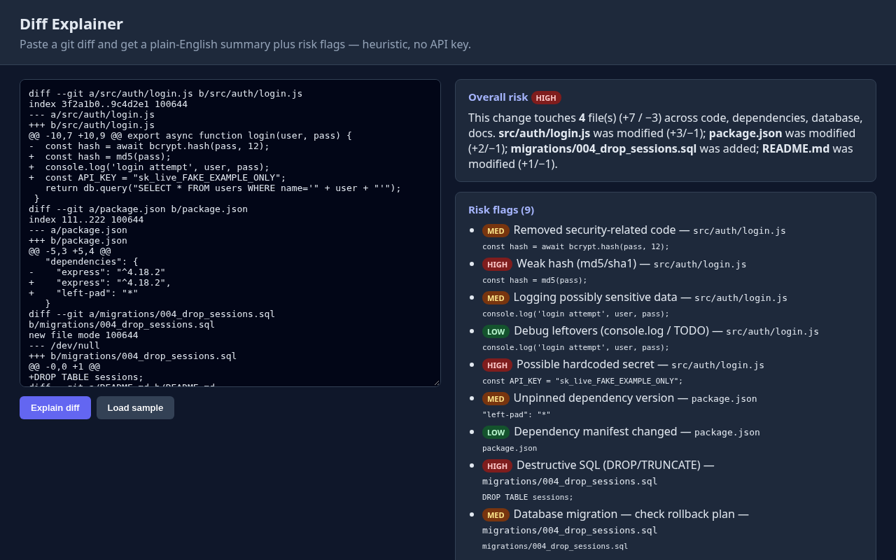

# Diff Explainer

Paste a git diff and get a plain-English summary plus risk flags — heuristic, no API key.



## Features
- Per-file summary (added/modified/deleted, +/- lines) and change areas (code, docs, config, deps, DB)
- Risk flags: hardcoded secrets, weak hashing, SQL concatenation, destructive SQL, eval/exec, unpinned deps, disabled TLS, removed security code, debug leftovers
- Overall LOW / MEDIUM / HIGH score

## Dependencies
- **Node.js 16+** (only to serve the static files; the app itself is plain HTML/JS)
- **No npm runtime dependencies**, no API keys, no network calls — everything runs client-side.

## Run
```bash
git clone https://github.com/YardPhantom/diff-explainer.git
cd diff-explainer
npm start            # or: node server.js 8080
# open http://localhost:8080   (add ?demo=1 to auto-load the sample)
```
You can also just open `public/index.html` directly in a browser.

## License
MIT © Trevor Heshka

---
Built by [Trevor Heshka](https://trevorheshka.com)
